# Loci

**Your room remembers.** Loci is a hands-first mixed-reality memory palace for Meta Quest 3 and 3S. Ask how something works and it is taught to you as a chain of stages, each one resting on a real piece of furniture in your room and joined to the next by a thread of gold light. Come back tomorrow and every stage is still on its object, waiting to be recalled.

Built with the Immersive Web SDK (WebXR) for the Meta VR Start Developer Competition 2026, Productivity track.

**Live:** https://loci-vr.vercel.app · **Demo video (2:56):** https://youtu.be/oSASO_MFoDQ

    

<p align="center"><a href="https://youtu.be/oSASO_MFoDQ">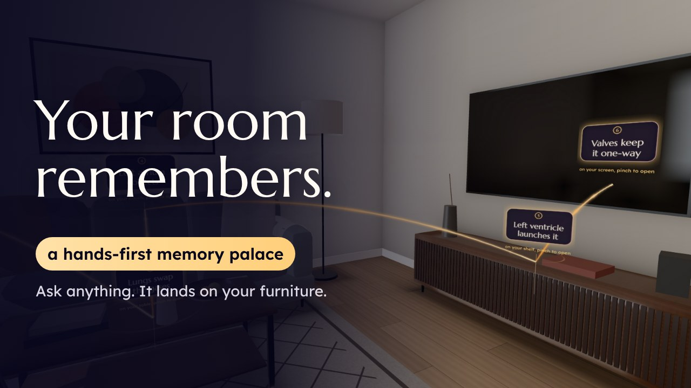</a><br><sub>Watch the demo (2:56). Every headset shot is a real emulator capture; nothing is AI-generated.</sub></p>

<p>
  
  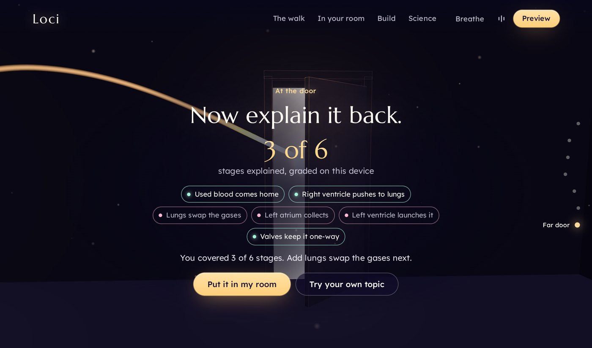
</p>
<p>
  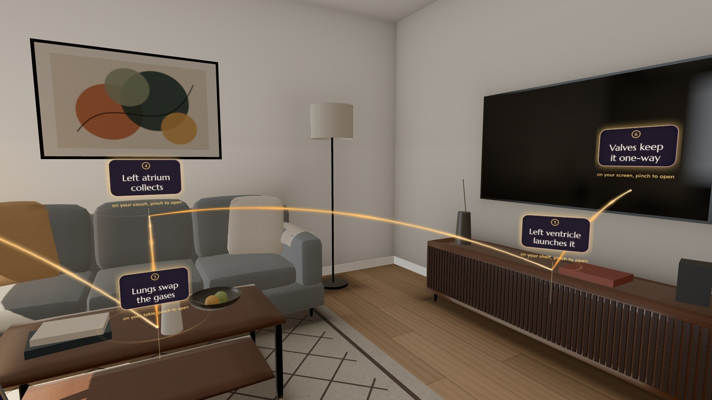
</p>

---

<p align="center">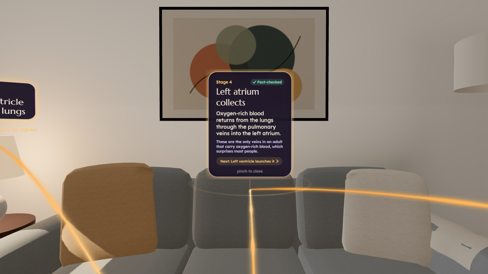 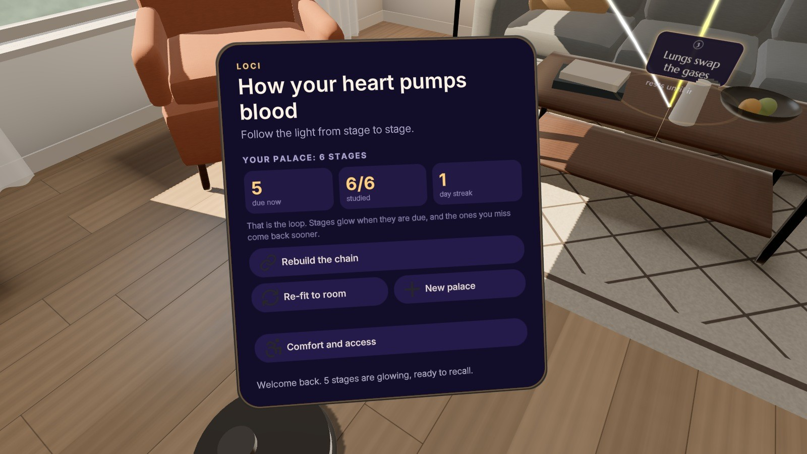</p>

## Built solo, without a headset

I'm a first-year student, and I built Loci without ever wearing a Quest. Every mixed-reality feature was built, tested and filmed in the Immersive Web Emulator, so the proof had to come from tests instead of from feel:

- **First minutes:** 3 pinches from a fresh install to the first opened stage (6 of 6 checks).
- **The day after:** every stage restored to its object, with the due ones awake (8 of 8).
- **No hands at all:** Look to select runs the whole loop with the hands disconnected (11 of 11). The glasses profile passes 9 of 9.
- **Any room:** all 8 synthetic rooms pass all 15 concept checks, and a 1,000-room property test places 9,037 stages with 0 collisions.
- **The Architect:** 20 of 20 live topics on the main cloud (median 2.8 s) and on the backup alone (median 4.0 s).

To film a headset I didn't have, I built a frame-by-frame rig inside the emulator. It pauses the app, steps it exactly 1/30 s, draws the emulator's room under the app and saves the frame: 3,220 frames across 20 takes, about 1.6 s each, for 107 s of headset footage. Not one frame is AI-generated.

<p align="center">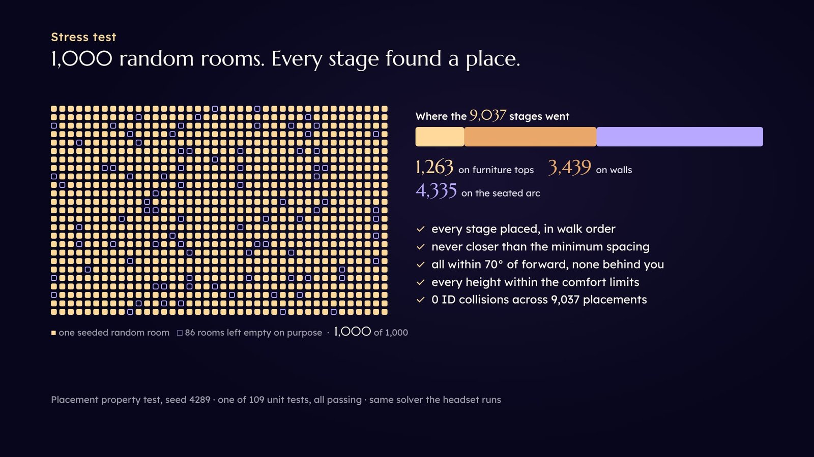 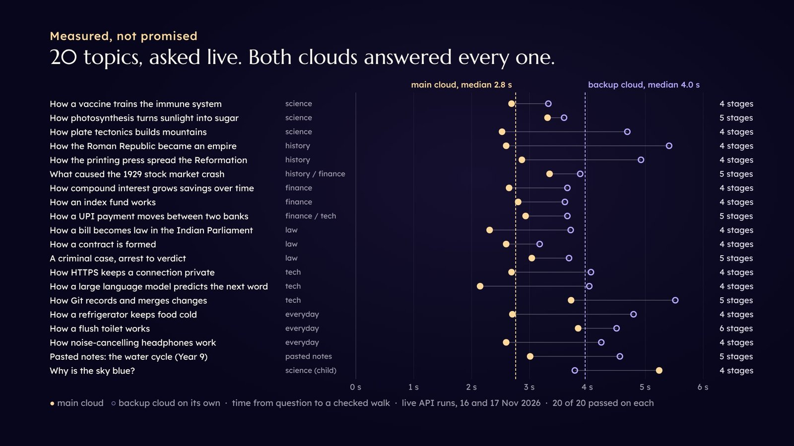</p>
<p align="center">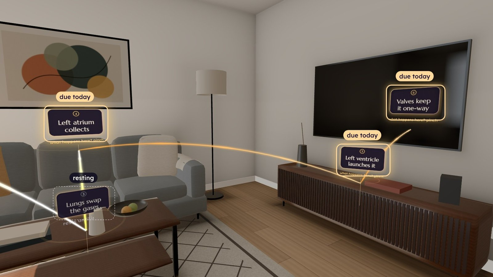 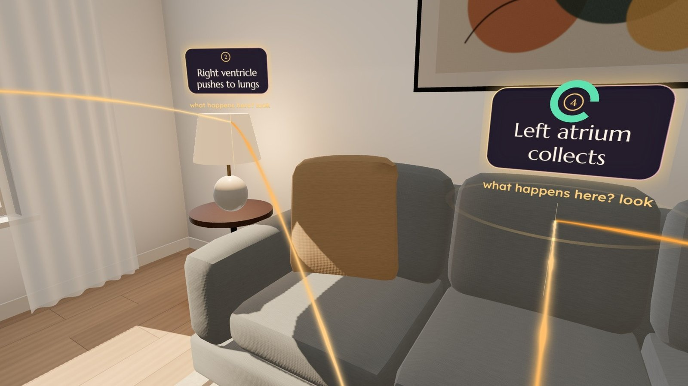</p>
<p align="center">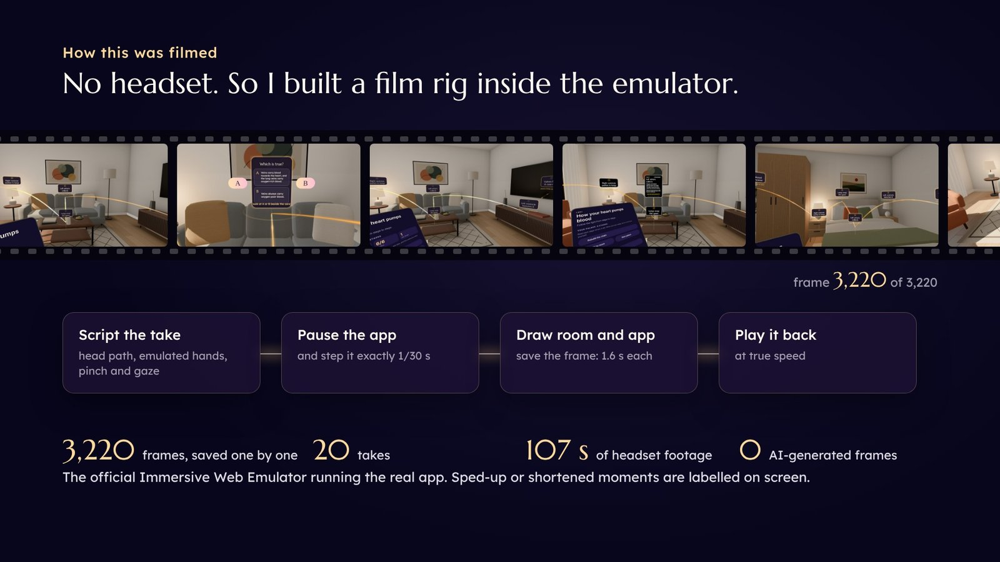</p>

## Try it in 60 seconds

> **On a Quest 3 or 3S**
> 1. Run **Space Setup** once (Settings > Environment setup > Space Setup) so the headset knows where your table, couch and shelves are. Loci still works without it, but then stages float in an arc in front of you instead of sitting on your furniture.
> 2. Open the **Quest Browser** and go to **https://loci-vr.vercel.app**. Press **Enter your room** and allow the room permissions.
> 3. Sit down. On the panel in front of you, pinch **Ask about anything**, type what you want to understand (starter words like *How does* save typing), then pinch **Teach me**. Ready-made walks are there too if you just want to see it work.
> 4. Follow the gold thread. **Pinch** a stage to turn it over, pick the true statement in its myth check, then hold it and **raise** it if you knew it or **lower** it to see it again soon.
>
> **On any screen (laptop, phone)**
> Open https://loci-vr.vercel.app and scroll. The page is a walk through a room at night: each stage of a concept sits at a different place, you answer its myth check, and at the door you explain it back in your own words and get graded.

## What it does

- **Concepts as linked stages on your real furniture.** A topic becomes 4 to 7 stages of how it works. Each stage sits on a different object, the route runs left to right so one sweep of the head walks it in order, and a gold thread joins each stage to the next and lights up as you recall them.
- **Myth checks.** Most stages carry two statements: a misconception real people hold and the accurate one. Picking the myth shows the correction and brings that stage back within minutes.
- **Explain-back, graded.** At the end of the website walk you explain the whole concept in your own words. The Palace Architect marks which stages you covered, names any misconception, and tells you what to add next. If the server cannot be reached, an offline grader on the device gives a blunter verdict from key words.
- **Spaced repetition with FSRS.** Every recall goes into an FSRS scheduler ([ts-fsrs](https://github.com/open-spaced-repetition/ts-fsrs)), so each stage comes back just before you would forget it. Using the hint counts as a harder recall.
- **The Palace Architect re-imagines a memory you miss twice.** When a stage lapses twice, its picture is rewritten around the object it sits on (a lamp heats, a couch sinks, a window fogs), up to two times per memory.
- **Seven ready-made walks**, so the first minute never waits on a network: the heart, plants, the seasons, vaccines, the water cycle, how a web page reaches you, and one for work: how a pull request gets merged.
- **Your own material.** Besides topics, you can paste notes, a list, a speech, names or numbers. Numbers are turned into pictures on the device and never leave it.
- **Ask from inside the headset.** The panel opens on *Ask about anything* with a keyboard on the panel; its chips turn into finished questions as you type, so most questions take a handful of pinches. On the website you can also type, paste, drop a text file or (where the browser supports it) ask out loud.
- **Rebuild the chain.** A second way to practise a concept: the thread goes dark, stage numbers hide, and you pinch the stages in the order things happen; each right pick relights the thread into that stage.
- **The Architect double-checks itself.** A second, conservative pass reads every generated stage again looking only for clear mistakes; a doubted stage says what to verify, on the website walk and on the opened card in the headset. In [our fact-check eval](docs/verify-eval.md) it passed all 8 shipped concepts clean and caught 6 of 8 planted errors on the right stage, in a median 905 ms; which error slips through varies run to run.
- **Share or export.** A concept you asked for can be copied as a link or downloaded as flashcards (CSV) for Anki and similar apps.
- **Real furniture hides what is behind it.** Where the headset can sense depth, stages are occluded by the real objects in front of them (requested as an optional feature, so headsets without depth still enter normally).
- **It shows it found your furniture.** A ring of light traces each real surface a stage rests on, in step with the thread igniting, and each label says *on your couch*.
- **A silent first lesson.** The first time, a small drawn hand pinches beside stage 1; once you open a stage it steps aside, and it comes back beside the A and B answers the first time a myth check opens. No text walls.
- **A finish line.** When every stage has been checked, the whole chain lights up again and Loci says when it will come back.
- **Reminders where you already look.** On the website, *Remind me* downloads a calendar file with your next three walks, tomorrow, in three days and in a week, each linking straight back to the palace. No account, no server, no notification permission. Coming back to the room, the panel says what is due or when the next stage returns.
- **Instant repeats.** A concept asked for before comes back instantly from the device or a warm server; if the Architect cannot be reached, questions that match a shipped concept still get their walk.

## How it works

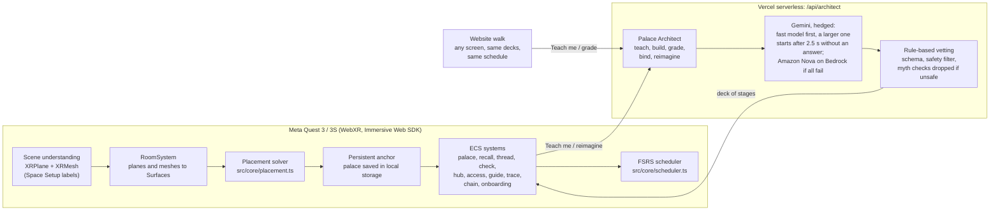

- **Room to surfaces.** `src/xr/room-system.ts` reads the planes and meshes the headset reports (from Space Setup) and reduces each one to a centre, a normal, a size and a label such as table, couch, shelf, wall or window.
- **Placement solver.** `src/core/placement.ts` is pure TypeScript with no engine imports. It turns surfaces into candidate slots, scores them for comfort (distance, how far you must turn, how distinctive the object is), spreads memories one per object, keeps tiles apart so none hides another from the seat, and orders the route left to right. Same room and same deck always give the same palace.
- **Persistent anchors.** The palace is stored as poses relative to a WebXR persistent anchor, so it comes back in the same place next session.
- **ECS.** The headset app is a set of entity-component systems (IWSDK's [ECS](https://iwsdk.dev)): each system queries the entities it cares about every frame, for example the recall system for tiles being held and the thread system for the gold links.
- **Palace Architect.** `api/architect.ts` runs on Vercel serverless. It asks Gemini for structured JSON. If the primary model has not answered in 2.5 s, the next model in the chain starts in parallel and the first good answer wins. Every line then passes a rule-based check (`src/core/architect.ts`, `src/core/safety.ts`): unsafe scenes are replaced with a plain one and a myth check is dropped if either statement fails. A second request (`mode: 'verify'`) then reads every stage again looking only for clear factual mistakes; a doubted stage carries what to check, and a clean one says it was fact-checked.

## Works in rooms we have never seen

Loci never assumes a particular room. Placement falls down a ladder:

1. **Labelled furniture first.** Distinct, nameable objects (table, desk, couch, shelf, lamp, plant) make the strongest places, so they are chosen before blank walls. A table reported twice, once as a labelled mesh and once as a bare plane, counts once.
2. **Then plain planes and walls**, at eye level on walls and just above horizontal tops.
3. **Then a seated arc in front of you**, in up to three rings, filling whatever the room could not. A completely empty or unscanned room still gets an even, symmetric palace.

Every slot stays within 70 degrees of where you face, so you never have to turn round in your chair.

On your return, the palace restores from its anchor and then **re-checks the room by meaning**: do memories still sit near objects with the same labels? If fewer than 40 percent do (you moved, or rearranged), Loci **re-fits** the palace to the furniture that is there now instead of leaving memories floating. You can also re-fit by hand from the panel.

The property test below throws 1,000 random rooms at the solver to back these claims.

## Hands-first and accessible

Every way to use Loci, and what each one covers:

| Way in | How | Covers |
| --- | --- | --- |
| Pinch | Point a hand at a stage or button and pinch | Everything |
| Gaze and pinch | Look at it, pinch with either hand (Meta VR Glasses) | Everything; hand rays take over if gaze drops out |
| Look to select | Hold your gaze until the ring fills; no hands | The panel and its keyboard, opening stages, myth checks, rating, rebuilding the chain |
| Read aloud | Answers are spoken when revealed | Every stage |
| High contrast and larger tiles | Black cards, white text, yellow edges; tiles 35% larger | Every card |
| Calm motion | No flights, hops or shakes; on by itself if the system asks for reduced motion | Every animation |


- **Pinch** with bare hands for everything: turn a stage over, choose a myth check answer, type on the panel keyboard.
- **Gaze and pinch on Meta VR Glasses.** The project requests gaze tracking (optional, so Quest 3 enters normally). Where the runtime has it, IWSDK's gaze aims at what you look at and a pinch from either hand selects: the panel, a concept, a stage. If gaze drops out, each hand's own far ray takes over. Checked on the emulator's glasses profile: [9 of 9](docs/e2e-glasses-run.txt), including that the panel fits the glasses' 74 by 68 degree view (37 left and right, 25 up, 43 down).
- **Look to select: the whole loop with no hands.** Hold your gaze on a button or a stage and a ring fills, then it presses: the panel, a ready-made walk, opening a stage, answering a myth check, rebuilding the chain. Your eyes aim where they are tracked (the glasses), your head where they are not (Quest 3). Panel buttons wait a little longer than stages, because they are also what you read, and after a press nothing on the panel arms until your gaze moves, so a button that appears under your eyes is never pressed by accident. Checked with the controllers and hands disconnected: [11 of 11](docs/e2e-look-run.txt), including typing a question by look.
- **Seated** by design: the whole palace fits in a comfortable turn from one chair.
- **High contrast**, **larger tiles**, **calm motion** and **read-aloud**, plus a sound switch, all on the panel in your room.
- Tiles on far objects are drawn larger so every one reads the same from your seat.

## Privacy

- **No accounts.** Palaces and progress live in your browser's local storage. Share links carry the palace inside the link itself.
- **Your notes leave the device only when you press Teach me** (or build), and only go to the Palace Architect endpoint to write the stages. After that, only short memory text is sent: a memory's cue and picture with its object's label when it is woven into your room or re-imagined, and your explanation when you ask for it to be graded. The API keeps no copy of any of it; it only counts requests per IP address in memory, for rate limiting.
- **Numbers are converted on the device** with the number-shape system, so a phone number or a date is never sent anywhere.

## Receipts

Every number here comes from a command that can be re-run. Generated 17 Nov 2026 (IST); `node scripts/receipts.mjs` re-runs the unit tests and writes [public/receipts.json](public/receipts.json). It also reads the concept e2e log, the room-matrix JSON and the Architect eval, and the website's numbers are imported from that same file. The perf section is copied from `scripts/perf.py` output.

| What | Result | Reproduce |
| --- | --- | --- |
| Unit tests | **109 passing** in 11 files, 0 failing (18 Nov 2026), including a check that the per-frame hand-sample ring allocates nothing and that a myth restating its own fact is dropped | `npx vitest run` |
| Placement property test | **1,000 seeded random rooms**, 6 to 12 memories each, 9,037 placements: every memory placed, no two closer than the solver's own minimum spacing, every slot within 70 degrees of forward and none behind the viewer, heights within the solver's limits | `npx vitest run tests/placement-property.test.ts` |
| Concept end-to-end in the Immersive Web Emulator | **15/15 checks** (18 Nov 2026, 15:16 IST, sunlit living room, commit c54c00b): pick a concept, stages land on distinct furniture, threads join and light, myth checks record recalls, exit and re-enter restores everything; restore drift **under 0.1 mm** | `python3 scripts/e2e-concept.py` with the dev server up |
| Ask and chain practice in the emulator | **8/8 checks** (17 Nov 2026, 20:09 IST, on a freshly loaded page): open Ask, type "How" with three key pinches and the chips become finished questions; build a concept; Rebuild the chain dims the thread and hides the numbers; a stage out of order is refused; the stages picked in order relight every link; finishing reports the run. [docs/e2e-chain-run.txt](docs/e2e-chain-run.txt) | `python3 scripts/e2e-chain.py` with the dev server up |
| Look-only, no hands, in the emulator | **11/11 checks** (18 Nov 2026, 15:35 IST, commit c54c00b): with controllers and hands disconnected and Look to select on, only the head turns: it opens Ask and types a question chip, opens the ready-made walks, staying put presses nothing else, a concept builds its palace, a stage opens its myth check, looking at the true statement answers it, and the whole chain is rebuilt stage by stage. [docs/e2e-look-run.txt](docs/e2e-look-run.txt) | `python3 scripts/e2e-look.py` with the dev server up |
| First minutes from a fresh install, in the emulator | **6/6 checks** (18 Nov 2026, 15:28 IST, commit c54c00b): storage cleared, page reloaded; the panel opens on Ask with the ready-made walks one pinch away; two pinches build a 6-stage palace; the first-run lesson draws a hand pinching beside stage 1; the third pinch opens stage 1 and the hand steps aside. **3 pinches from a fresh install to the first opened stage.** [docs/e2e-first-run.txt](docs/e2e-first-run.txt) | `python3 scripts/e2e-first.py` with the dev server up |
| The day after, in the emulator | **8/8 checks** (17 Nov 2026, 19:16 IST): from a fresh install, build the heart walk and study every stage once with a real FSRS review (nothing due); move every saved date back one day, as if it had passed; leave mixed reality and come back. Every stage is restored to the same spot (0.0 mm drift), all 6 are due again and drawn awake, the panel docks clear of every stage and says *Welcome back. 6 stages are glowing, ready to recall.*, and the guide leads to stage 1. [docs/e2e-return-run.txt](docs/e2e-return-run.txt) | `python3 scripts/e2e-return.py` with the dev server up |
| Meta VR Glasses profile in the emulator | **9/9 checks** (17 Nov 2026, 20:26 IST, hands resting at the sides): glasses profile with gaze-tracking granted; the panel fits the 74 x 68 degree view open and docked; gaze plus a right-hand pinch opens the walks, gaze plus a left-hand pinch builds a palace, gaze plus a pinch opens a stage; with gaze disconnected a hand ray opens a stage. [docs/e2e-glasses-run.txt](docs/e2e-glasses-run.txt) | set `dev.emulator.device` to `metaVRGlasses`, then `python3 scripts/e2e-glasses.py` |
| Room matrix in the emulator | **8 of 8 synthetic rooms pass all 15 checks on the first try** (bedroom, conference room, home office, kitchen, music studio, open office, open studio, sunlit living room), in one full pass with no re-runs. 47 of 48 stages landed on the room's furniture and walls, 1 on the seated arc; restore drift under 0.1 mm in every room. With no scene data at all, all 6 stages fell back to the seated arc and 15 of 15 checks passed. 16 Nov 2026, 15:50 to 18:07 IST. [docs/test-matrix.md](docs/test-matrix.md) | `python3 scripts/matrix.py --tag=pass1` with the dev server up |
| Frame cost in the emulator | Concept palace on screen (6 stages, threads, 4 trace rings, hub open), 300 frames: world update + render **4.6 ms p50, 8.1 ms p95** of CPU; 64 draw calls, 21,668 triangles. Per system: Loci's own systems take well under 1 ms a frame on average; the largest cost is the framework's input system on emulated hands (2.1 ms mean). Profiling found the hub re-sending unchanged panel text every 2 s; skipping identical writes cut its mean from 0.41 to 0.26 ms. Software GL (SwiftShader), so relative numbers only, not Quest frame times. 16 Nov 2026, 18:27 to 18:39 IST. [docs/perf.md](docs/perf.md) | `python3 scripts/perf.py 300` and `--systems` with the dev server up |
| Palace Architect, live teach mode | **20 of 20 topics** taught (science, history, finance, law, tech, everyday, pasted notes, a child audience); median 4 stages, **83 of 88 stages kept a myth check**, median **2.7 s** server time (2.8 s wall), 16 Nov 2026, 15:43 IST | `node scripts/eval-architect.mjs` |
| Architect backup alone (Amazon Nova on AWS Bedrock) | **20 of 20 topics** with Gemini skipped and no fallback, same 20 topics; median 5 stages, **97 of 106 stages kept a myth check**, median **3.9 s** server time (4.0 s wall), 17 Nov 2026, 22:13 IST. [docs/architect-eval-bedrock.md](docs/architect-eval-bedrock.md) | `node scripts/eval-architect.mjs --bedrock` |

The full Architect run, with a per-topic table and two complete outputs, is in [docs/architect-eval.md](docs/architect-eval.md). In that run all 20 answers came from the primary model (`gemini-3.5-flash-lite`) inside the 2.5 s hedge window, so no fallback started. An earlier run, when a slower model led the chain, took a median 6.1 s and every answer came from the fallback, which is why the fast model now leads.

Gemini can be overloaded (we saw intermittent 503s on 17 Nov). When every Gemini model fails, the last link in the chain is Amazon Nova 2 Lite on AWS Bedrock, called through the Converse API with the answer schema as a forced tool so it returns the same shape. Measured alone on the same 20 topics it taught all 20, a little slower than Gemini (3.9 s against 2.7 s median), so it stays the backup rather than the lead. It only switches on when AWS credentials are set, and the IAM user may only invoke models.

How the property test's 9,037 placements split: 1,263 on furniture tops, 3,439 on walls, 4,335 on the seated arc. 86 of the 1,000 rooms were empty on purpose.

## The research behind it

- **Place cells and grid cells.** The brain has a dedicated system for knowing where you are. [Nobel Prize in Physiology or Medicine 2014](https://www.nobelprize.org/prizes/medicine/2014/summary/) (O'Keefe, Moser and Moser).
- **Memory champions use places, not special brains.** Superior memorizers rely on spatial learning; 9 of the 10 scanned said they used the method of loci for some or all of the tasks. [Maguire et al., 2003, *Nature Neuroscience*](https://doi.org/10.1038/nn988).
- **The method can be learned, and it lasts.** After 40 days of 30-minute method-of-loci sessions, people with ordinary memory went from recalling 26 of 72 words to 62, their brain networks came to resemble memory athletes', and the gain largely held four months later. [Dresler et al., 2017, *Neuron*](https://doi.org/10.1016/j.neuron.2017.02.003).
- **Virtual memory palaces work.** People recalled more with a memory palace in a head-mounted display than on a desktop. [Krokos, Plaisant and Varshney, 2018, *Virtual Reality*](https://doi.org/10.1007/s10055-018-0346-3).
- **Testing beats rereading.** Retrieval practice produces better long-term retention than study alone, which is why Loci asks you to recall before it shows you. [Roediger and Karpicke, 2006, *Psychological Science*](https://doi.org/10.1111/j.1467-9280.2006.01693.x).
- **Spacing beats cramming.** [Cepeda et al., 2006, *Psychological Bulletin*](https://doi.org/10.1037/0033-2909.132.3.354), a meta-analysis of distributed practice.
- **FSRS**, the open spaced-repetition scheduler Loci uses: [open-spaced-repetition/ts-fsrs](https://github.com/open-spaced-repetition/ts-fsrs).

## Development

Requires Node 20.19+, 22.12+ or 24+.

```sh
npm install
npm run dev          # IWSDK CLI managed dev server, opens a browser with the Quest emulator (IWER)
npm test             # unit tests (vitest)
npm run typecheck    # tsc --noEmit
```

- `npm run dev` runs the dev server through the IWSDK CLI (`iwsdk dev`), not plain Vite. `iwsdk.config.json` is the project's source of truth for the scene and XR features. IWER is IWSDK's browser-based XR emulator; see [Testing your experience](https://iwsdk.dev/guides/02-testing-experience.html).
- End-to-end tests drive the emulator with the dev server up: `python3 scripts/e2e.py` (list palace) and `python3 scripts/e2e-concept.py` (concept palace).
- `node scripts/eval-architect.mjs` runs the live Architect evaluation (about 11 minutes; it paces itself under the API's rate limit). `node scripts/receipts.mjs` refreshes `public/receipts.json`.
- The Architect needs `GEMINI_API_KEY` set on the server (see `.env.example`). The Amazon Nova backup is optional and needs AWS credentials for an IAM user limited to `bedrock:InvokeModel`.

```
src/core/     pure logic, no engine imports: placement, scheduler, concepts, safety, grading
src/xr/       headset ECS systems: room, palace, recall, thread, check, hub, access
src/site/     the website walk
api/          Palace Architect (Vercel serverless)
tests/        vitest unit and property tests
scripts/      e2e, evaluation and receipts scripts
```

## Known limits

- **Not yet run on a physical Quest.** All mixed-reality testing so far is in the Immersive Web Emulator with synthetic rooms. Hand tracking, real Space Setup data and real anchor persistence still need a headset session.
- **The emulator e2e runs on software GL**, so it proves behaviour, not frame rate. The [perf receipt](docs/perf.md) measures CPU per frame and draw calls in the emulator only; frame rate and GPU cost on a Quest are unmeasured.
- **The emulator rooms are synthetic.** The [room matrix](docs/test-matrix.md) covers IWER's eight built-in rooms and an empty one; a real Space Setup scan will report different labels and shapes. In the headless emulator (about one frame a second) a short scripted press could miss a frame; the e2e now holds each pinch for 1.4 s, and the latest full pass needed no re-runs.
- **Glasses: a hand resting right under the docked panel pauses gaze.** IWSDK pauses gaze while a hand hovers anything near, by design. Turning that off kept gaze alive but stopped controller rays from pressing panel buttons on Quest 3, so we kept the default; on the glasses, rest your hands at your sides or in your lap below the panel.
- **The Architect can be wrong.** Its stages and myth checks are generated by a language model, rule-checked for safety and shape, then fact-checked by a second model pass. That pass caught 6 of 8 planted errors in [our eval](docs/verify-eval.md), but it is a model too: a stage marked fact-checked is less likely to be wrong, not guaranteed right. The ready-made concepts were also checked by hand. In our 20-topic run, the vetting kept 83 of 88 myth checks; one topic (the Roman Republic) kept only 1 of 4, in this run and the one before it.

## License

[MIT](LICENSE)
